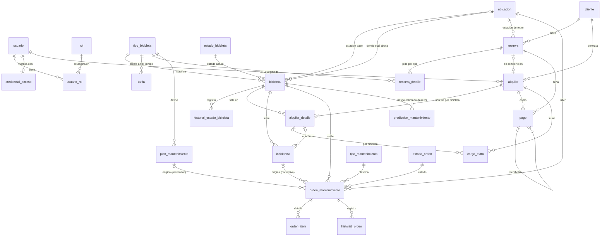

# Modelo de datos

Relaciones principales del esquema (`db/schema.sql`). Las claves foráneas son todas reales; los
historiales y la auditoría no se dibujan con todos sus vínculos para que el diagrama se pueda leer.

## Vistas

| Vista | Para qué sirve |
| --- | --- |
| `v_disponibilidad_estacion` | Flota, disponibles, alquiladas y en taller por estación y tipo. |
| `v_alquileres_demorados` | Alquileres en curso que ya pasaron su hora de devolución. |
| `v_reservas_por_vencer` | Reservas vigentes cuyo cliente no se presentó pasada la tolerancia. |
| `v_saldo_alquiler` | Lo devengado, lo cobrado (la seña de la reserva cuenta) y el saldo. |
| `v_ingresos_mensuales` | Ingresos, horas y bicicletas alquiladas por mes y tipo. |
| `v_rentabilidad_bicicleta` | Ingresos y cargos menos mantenimiento, por bicicleta. |
| `v_ritmo_uso` | Horas de uso por día de cada bicicleta en los últimos 90 días. |
| `v_ultimo_servicio` | Último servicio preventivo cerrado de cada tarea del plan. |
| `v_proximo_servicio` | Horas y días que faltan para cada tarea, y fecha estimada según el ritmo de uso. |
